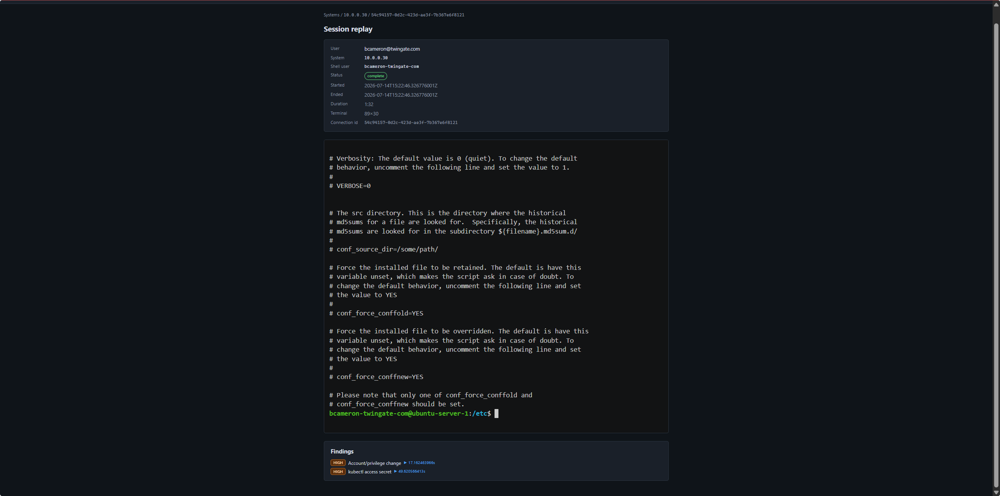

# Gatorcast

> **⚠️ Example project — provided as-is, with no support or warranty.** Gatorcast is published as a reference example to build from, not a supported product. Nothing here is guaranteed and no support is attached to it. It was developed with help from an LLM-based coding assistant. **Review the code and test it yourself before using it in any critical or production environment.** Your use is governed by the [Apache License 2.0](LICENSE), including its "AS IS", no-warranty (Section 7), and limitation-of-liability (Section 8) terms.

Self-hosted, single-container service for **Twingate Identity Firewall Gateway session recordings**. The Twingate Gateway records interactive privileged sessions (`kubectl exec`, SSH shells) as asciicast v2 fragments and emits them via structured JSON audit logs. Gatorcast receives those log lines by push (HTTP POST or syslog TCP), demultiplexes concurrent sessions by `conn_id`, reassembles each into a complete asciicast v2 document, stores it, and serves a lightweight web UI to browse **systems → sessions → replay** in a locally vendored asciinema player. All recordings stay on your infrastructure.

It also stores the Gateway's per-request Kubernetes API audit lines as allowlisted **kubectl activity**, and web-app requests as **web activity** with the app's configured TLS posture. Built-in rules flag dangerous commands and on-screen secrets live, and one search covers every event kind.



---

## Quickstart

**Prerequisites:** Docker and Docker Compose.

### 1. Get the files

```bash
git clone https://github.com/Twingate-Solutions/gatorcast.git
cd gatorcast
```

The `docker-compose.yml` pulls the image from GHCR — it never builds locally.

### 2. Create your `.env`

```bash
cp .env.example .env
```

Edit `.env` and set strong values for all three secrets:

```bash
INGEST_TOKEN=<long-random-string>    # Bearer token your shipper presents to /ingest
UI_AUTH_USERNAME=<your-username>     # Web UI login
UI_AUTH_PASSWORD=<strong-password>   # Web UI password
```

> **Important:** Gatorcast logs a warning at startup (`config.insecure_default`) if any of these values are still equal to the placeholder defaults (`change-me-long-random`, `admin`, `change-me`). The service will still start, but do not run it on a network with those defaults in place.

### 3. Start the service

```bash
docker compose pull
docker compose up -d
```

### 4. Browse the UI

Open `http://<your-host>:8080` in a browser. You will be prompted for the `UI_AUTH_USERNAME` and `UI_AUTH_PASSWORD` you set above.

Sessions appear as soon as a shipper begins forwarding Gateway logs. To forward logs in, see [Ingestion](https://github.com/Twingate-Solutions/gatorcast/wiki/Ingestion-Overview).

---

## Documentation

Everything beyond the quick start is in the [wiki](https://github.com/Twingate-Solutions/gatorcast/wiki).

- **Getting started:** [Configuration](https://github.com/Twingate-Solutions/gatorcast/wiki/Configuration) · [Reverse proxy](https://github.com/Twingate-Solutions/gatorcast/wiki/Reverse-Proxy-Deployment) · [Upgrading](https://github.com/Twingate-Solutions/gatorcast/wiki/Upgrading)
- **Ingestion:** [Overview](https://github.com/Twingate-Solutions/gatorcast/wiki/Ingestion-Overview) · [systemd VM](https://github.com/Twingate-Solutions/gatorcast/wiki/Ingestion-systemd-VM) · [Terraform](https://github.com/Twingate-Solutions/gatorcast/wiki/Ingestion-Terraform) · [Docker](https://github.com/Twingate-Solutions/gatorcast/wiki/Ingestion-Docker) · [Kubernetes](https://github.com/Twingate-Solutions/gatorcast/wiki/Ingestion-Kubernetes) · [curl test](https://github.com/Twingate-Solutions/gatorcast/wiki/Ingestion-Manual-Test)
- **Using Gatorcast:** [UI tour](https://github.com/Twingate-Solutions/gatorcast/wiki/UI-Tour) · [Search](https://github.com/Twingate-Solutions/gatorcast/wiki/Search) · [Detection rules](https://github.com/Twingate-Solutions/gatorcast/wiki/Detection-Rules) · [kubectl activity](https://github.com/Twingate-Solutions/gatorcast/wiki/kubectl-Activity) · [Web apps](https://github.com/Twingate-Solutions/gatorcast/wiki/Web-Apps)
- **Operations:** [Security model](https://github.com/Twingate-Solutions/gatorcast/wiki/Security-Model) · [Encryption at rest](https://github.com/Twingate-Solutions/gatorcast/wiki/Encryption-at-Rest) · [Retention](https://github.com/Twingate-Solutions/gatorcast/wiki/Retention) · [Troubleshooting](https://github.com/Twingate-Solutions/gatorcast/wiki/Troubleshooting)
- **Internals:** [Architecture](https://github.com/Twingate-Solutions/gatorcast/wiki/Architecture) · [Testing](https://github.com/Twingate-Solutions/gatorcast/wiki/Testing)
- **Releases:** [CHANGELOG.md](CHANGELOG.md)

---

## License

Gatorcast is licensed under the [Apache License 2.0](LICENSE). It is provided on an "AS IS" basis, without warranties or conditions of any kind — see the disclaimer at the top of this README and Sections 7 and 8 of the license.
